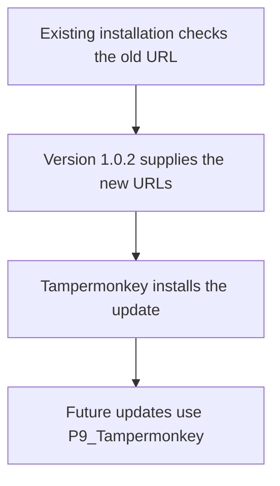

# TCG PowerTools: stay on the legacy app

**This script is now maintained in [P9_Tampermonkey](https://github.com/tjx0726/P9_Tampermonkey/tree/main/tcgpowertools-block-redirect).**

**[Install or update the userscript](https://raw.githubusercontent.com/tjx0726/P9_Tampermonkey/main/tcgpowertools-block-redirect/tcgpowertools-stay-on-legacy.user.js)**

This repository retains version `1.0.2` at the original file path as an update
entry point for existing installations. Keep that file available so browsers
that have been offline can still migrate later.

This Tampermonkey script cancels navigation from `app.tcgpowertools.com` to
`https://new.tcgpowertools.com/login-redirect`, including the `window.location.href`
assignment in the supplied `AppLayout.tsx`. It uses the Navigation API supported
by current Chrome and Chromium browsers.

## Install once

1. Open the install link above with Tampermonkey enabled and confirm the script
   installation. If the browser displays the source instead, use Tampermonkey
   **Dashboard → Utilities → Install from URL** with the same link.
2. If you previously pasted version `1.0.0` into the editor, install from this URL
   once to replace that copy and register the update source. The script name and
   namespace are unchanged. Keep only one enabled copy in the dashboard.
3. Ensure the script is enabled and Tampermonkey has access to
   `https://app.tcgpowertools.com/*`.
4. In Chrome's extension settings, enable **Allow User Scripts** for Tampermonkey
   if needed. Older Chromium versions may use **Developer mode** instead.
5. Open [the legacy app](https://app.tcgpowertools.com/) directly and reload it.

See Tampermonkey's [installation FAQ](https://www.tampermonkey.net/faq.php?q=Q102)
and [userscript permission instructions](https://www.tampermonkey.net/faq.php?q=Q209).

## Receive updates from GitHub

Version `1.0.2` points both `@updateURL` and `@downloadURL` at the script in
`P9_Tampermonkey` on its `main` branch. The script name and namespace remain
unchanged, and the redirect-blocking code is unchanged from `1.0.1`.

An existing `1.0.1` installation checks this repository's original raw URL,
finds the higher version, and receives the script with the new update metadata.
Once that update is installed, subsequent update checks use `P9_Tampermonkey`.
See the maintainer's [update-URL migration explanation](https://github.com/Tampermonkey/tampermonkey/issues/1904).

This requires an installation with a working update source and script updating
enabled. A manually pasted copy with no update source needs a one-time install
from the link above. A locally modified script or an overridden update URL may
also require a manual update. Publishing this migration cannot change settings
on other computers or establish that every installed copy has updated.

See the [update metadata documentation](https://www.tampermonkey.net/documentation.php?locale=en&q=update_url).

In Tampermonkey's dashboard settings, enable periodic script update checks and
choose your preferred interval. Enable **Automatic installation** as well if
updates should install without a separate confirmation. Tampermonkey 5.5
separates update checks from installation; checking alone does not establish
that automatic installation is enabled.
See the [Tampermonkey changelog](https://www.tampermonkey.net/changelog.php?more=true&old=&show=dhdg).

Updates arrive when Tampermonkey next checks; a GitHub push does not immediately
update every browser. You can use Tampermonkey's manual update check to check
sooner. Reload the app after an update to run the new version. Avoid editing the
installed copy in Tampermonkey: locally modified scripts may stop updating
automatically, as described in the same changelog.

### Publish a future update

1. Edit `tcgpowertools-block-redirect/tcgpowertools-stay-on-legacy.user.js` in
   [P9_Tampermonkey](https://github.com/tjx0726/P9_Tampermonkey).
2. Increase `@version`, for example from `1.0.2` to `1.0.3`. Preserve `@name`,
   `@namespace`, and the update/download URLs.
3. From that repository's root, run
   `node --check tcgpowertools-block-redirect/tcgpowertools-stay-on-legacy.user.js`
   and verify any changed runtime behavior.
4. Update its README catalog and CHANGELOG, then commit the changes and push or
   merge them into `P9_Tampermonkey/main`. Local edits and commits that have not
   reached `main` are not distributed to users. Keep this repository's `1.0.2`
   migration entry available; future runtime changes belong in the new repository.

To share installed scripts between browsers, Tampermonkey also offers optional
**Script Sync**. That is separate from fetching new releases from this GitHub
repository. See the [Script Sync FAQ](https://www.tampermonkey.net/faq.php?q=Q105).

## Scope and limitations

- The script matches only the legacy app. It cancels navigation to the specified
  login-redirect endpoint, with or without a trailing slash, including a link to
  that endpoint clicked on the page. Other destinations remain available.
- It does not rewrite the deployed TypeScript, change account flags, or read
  cookies. Console messages exclude the destination query string and JWT.
- It requests `document-start` execution so the listener can be installed before
  the app tries to navigate. Actual injection timing depends on the browser and
  extension configuration.
- It does not prevent a server redirect before the page loads or navigations the
  browser marks non-cancelable.
- The supplied component separately calls `updateNewUsers()` for accounts created
  after January 1, 2025. That function updates the profile, calls `setUser()`, and
  fetches the user again, while its effect depends on `[user]`. Staying on the page
  may expose a repeated update/fetch loop. This script does not fix that site bug;
  if it occurs, disable the script and reload.

To undo the redirect blocking, disable the script in Tampermonkey and reload.

## Validation

Version `1.0.2` changes the version, homepage, update URL and download URL.
Its runtime body is unchanged from `1.0.1`. The old and new repository copies
are identical; JavaScript syntax and migration metadata were checked.

Version `1.0.1` adds distribution metadata; its runtime body is unchanged from
`1.0.0`. JavaScript syntax and metadata were checked, and the runtime body was
compared with the original script.

The original runtime passed 12 assertions in isolated Chrome 152 with all
network responses simulated. An initial inline `window.location.href` redirect
was canceled even though its cross-origin event had `canIntercept: false`.
Normal history changes, same-origin document navigation, other paths on the new
app, and unrelated destinations remained functional. No request reached the
blocked endpoint and no test token appeared in console messages.

These checks did not use an authenticated account or an actual Tampermonkey
installation. They do not verify extension injection timing or end-to-end
automatic updating in your browser.

## Technical references

- [Chrome Navigation API: cancellation versus interception](https://developer.chrome.com/docs/web-platform/navigation-api)
- [Tampermonkey: document-start](https://www.tampermonkey.net/documentation.php?q=run_at)
- [Tampermonkey: page context](https://www.tampermonkey.net/documentation.php?q=sandbox)
