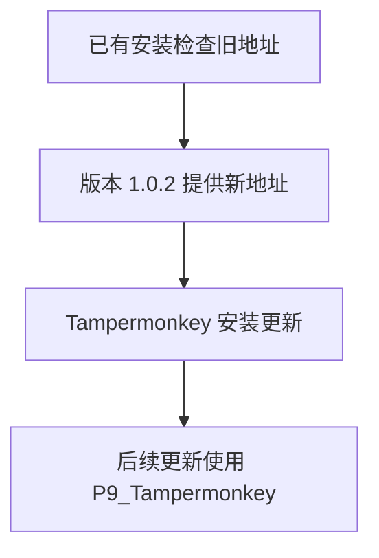

# TCG PowerTools：停留在旧版应用

[English](README.md) · [中文](README.zh-CN.md)

**此脚本现由 [P9_Tampermonkey](https://github.com/tjx0726/P9_Tampermonkey/tree/main/tcgpowertools-block-redirect) 维护。**

**[安装或更新脚本](https://raw.githubusercontent.com/tjx0726/P9_Tampermonkey/main/tcgpowertools-block-redirect/tcgpowertools-stay-on-legacy.user.js)**

本仓库在原始文件路径保留版本 `1.0.2`，作为已有安装的更新入口。请保留该文件，以便长期未联网的浏览器以后仍能迁移。

此 Tampermonkey 脚本取消从 `app.tcgpowertools.com` 到 `https://new.tcgpowertools.com/login-redirect` 的导航，包括所提供 `AppLayout.tsx` 中的 `window.location.href` 赋值。它使用当前 Chrome 和 Chromium 浏览器支持的 Navigation API。

## 安装一次

1. 在已启用 Tampermonkey 的浏览器中打开上方安装链接并确认安装。如果浏览器直接显示源码，在 Tampermonkey 的 **Dashboard → Utilities → Install from URL** 中使用同一链接安装。
2. 如果之前将版本 `1.0.0` 粘贴到编辑器中，请通过该链接安装一次，替换旧副本并登记更新来源。脚本名称和 namespace 保持不变；请在管理面板中只保留一个启用的副本。
3. 确保脚本已启用，且 Tampermonkey 有权访问 `https://app.tcgpowertools.com/*`。
4. 如有需要，在 Chrome 扩展设置中为 Tampermonkey 开启 **Allow User Scripts**。旧版 Chromium 可能使用 **Developer mode**。
5. 直接打开[旧版应用](https://app.tcgpowertools.com/)并刷新。

请参阅 Tampermonkey 的[安装常见问题](https://www.tampermonkey.net/faq.php?q=Q102)和[用户脚本权限说明](https://www.tampermonkey.net/faq.php?q=Q209)。

## 从 GitHub 接收更新

版本 `1.0.2` 的 `@updateURL` 和 `@downloadURL` 均指向 `P9_Tampermonkey` 仓库 `main` 分支中的脚本。脚本名称和 namespace 保持不变，重定向拦截代码与 `1.0.1` 一致。

已有的 `1.0.1` 安装会先检查本仓库原始 Raw 地址，发现更高版本后获取包含新更新元数据的脚本。安装该更新后，后续检查会使用 `P9_Tampermonkey`。请参阅维护者的[更新地址迁移说明](https://github.com/Tampermonkey/tampermonkey/issues/1904)。

迁移要求已有安装具有有效的更新来源，且启用脚本更新。没有更新来源的手动副本需要通过上方链接安装一次。本地修改过的脚本或被覆盖的更新地址也可能需要手动更新。发布迁移版本无法修改其他电脑的设置，也不能证明所有已安装副本都已完成更新。

请参阅[更新元数据文档](https://www.tampermonkey.net/documentation.php?locale=en&q=update_url)。

在 Tampermonkey 管理面板设置中启用定期脚本更新检查，并选择合适的间隔。如果希望无需单独确认即可安装更新，请同时启用 **Automatic installation**。Tampermonkey 5.5 将更新检查与安装分开；启用检查并不代表已经启用自动安装。请参阅 [Tampermonkey 更新记录](https://www.tampermonkey.net/changelog.php?more=true&old=&show=dhdg)。

更新会在 Tampermonkey 下次检查时发现；向 GitHub 推送不会立即更新所有浏览器。可以手动检查更新以提前触发检查。安装更新后刷新应用以运行新版。避免在 Tampermonkey 内修改已安装副本；同一更新记录说明，本地修改可能导致脚本停止自动更新。

### 发布后续更新

1. 在 [P9_Tampermonkey](https://github.com/tjx0726/P9_Tampermonkey) 中编辑 `tcgpowertools-block-redirect/tcgpowertools-stay-on-legacy.user.js`。
2. 提高 `@version`，例如从 `1.0.2` 升至 `1.0.3`。保留 `@name`、`@namespace` 和更新及下载地址。
3. 在新仓库根目录运行 `node --check tcgpowertools-block-redirect/tcgpowertools-stay-on-legacy.user.js`，并验证改动涉及的运行行为。
4. 更新新仓库 README 目录和 CHANGELOG，提交并推送或合并到 `P9_Tampermonkey/main`。尚未进入 `main` 的本地改动和提交不会分发给用户。保留本仓库的 `1.0.2` 迁移入口；后续运行逻辑应在新仓库修改。

Tampermonkey 也提供可选的 **Script Sync**，用于在浏览器间共享已安装脚本。它与从本 GitHub 仓库获取新版是两个独立功能。请参阅[脚本同步常见问题](https://www.tampermonkey.net/faq.php?q=Q105)。

## 范围与限制

- 脚本只匹配旧版应用，取消到指定 login-redirect 入口的导航，包括路径末尾带或不带斜杠的情况，以及从页面点击该目标链接的情况。其他目标仍可访问。
- 不重写部署中的 TypeScript，不修改账户标记，不读取 cookies。控制台信息不包含目标地址的查询字符串和 JWT。
- 请求在 `document-start` 执行，以便在应用尝试跳转前注册监听器。实际注入时机取决于浏览器和扩展配置。
- 无法阻止页面加载前的服务端重定向，也无法阻止浏览器标记为不可取消的导航。
- 所提供的组件还会针对 2025 年 1 月 1 日之后创建的账户调用 `updateNewUsers()`。该函数更新用户资料、调用 `setUser()`，并再次获取用户，而其 effect 依赖 `[user]`。停留在页面上可能暴露重复更新与获取的循环。此脚本不修复该网站问题；若出现问题，请禁用脚本并刷新。

如需撤销重定向拦截，在 Tampermonkey 中禁用脚本并刷新页面。

## 验证记录

版本 `1.0.2` 修改版本号、主页、更新地址和下载地址，执行逻辑与 `1.0.1` 一致。新旧仓库的副本完全相同；已检查 JavaScript 语法和迁移元数据。

版本 `1.0.1` 添加分发元数据，执行逻辑与 `1.0.0` 一致。已检查 JavaScript 语法和元数据，并与原始脚本比较执行逻辑。

原始运行逻辑曾在隔离的 Chrome 152 中通过 12 项断言，所有网络响应均为模拟。页面初始内联代码触发的 `window.location.href` 重定向被取消，尽管其跨域事件的 `canIntercept: false`。普通 history 修改、同源文档导航、新版应用的其他路径以及无关目标均保持正常。没有请求到达被拦截入口，控制台信息中也没有出现测试 token。

上述检查未使用已登录账户或实际安装的 Tampermonkey，因此不能验证扩展注入时机，也不能验证浏览器内端到端自动更新。

## 技术参考

- [Chrome Navigation API：取消与拦截的区别](https://developer.chrome.com/docs/web-platform/navigation-api)
- [Tampermonkey：document-start](https://www.tampermonkey.net/documentation.php?q=run_at)
- [Tampermonkey：页面上下文](https://www.tampermonkey.net/documentation.php?q=sandbox)
